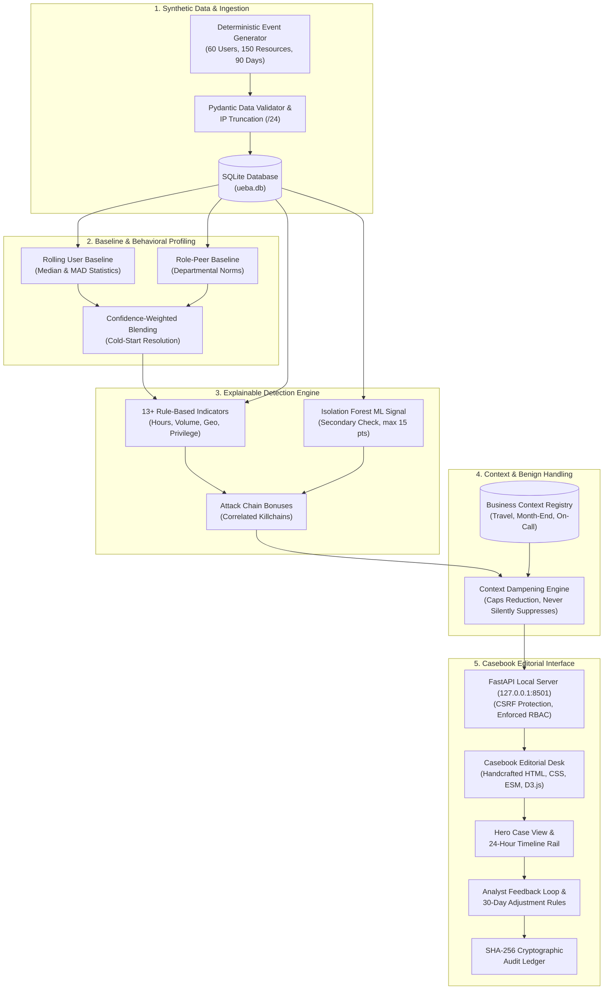

# Insider Threat Detection and User Behavior Analytics (UEBA) Platform

[](https://www.python.org/downloads/)
[](https://opensource.org/licenses/MIT)
[-warmpaper.svg)](http://localhost:8501)
[](https://www.sqlite.org/)

An explainable, privacy-preserving, and context-aware **User and Entity Behavior Analytics (UEBA)** platform designed to detect anomalous insider activity, account compromise, and data exfiltration while minimizing false positives and protecting employee dignity.

The user interface—**Casebook**—is modeled after an analyst's editorial desk: calm typography, warm paper tones, zero noisy dashboard widgets, real typographic scales, and the guiding philosophy that *"an anomaly is not proof of wrongdoing"*.

> [!IMPORTANT]
> **Core Principle:** An anomaly is **NOT** proof of wrongdoing. All findings are presented with explainable context and indicators requiring review—never pre-judging guilt. Benign-exception handling is a first-class architectural capability.

---

## 1. Problem & Solution Overview

### The Problem
Insider threats account for some of the most expensive and damaging security breaches. However, conventional monitoring approaches fail:
- **Alert Fatigue:** Rules that trigger on simple thresholds flag legitimate operations (e.g., month-end accounting, scheduled on-call shifts, or approved international travel).
- **Privacy Violations:** Invasive surveillance (keyloggers, screen recording) violates labor laws, works council agreements, GDPR, and India's DPDP Act.
- **Black-Box Confusion:** Pure machine learning systems output arbitrary risk numbers without actionable, event-level justification.

### The Solution
Our UEBA platform introduces four core innovations:
1. **Explainable Indicator Cards & Human Narrative:** Every alert decomposes into specific rule-based indicators linking directly to raw audit event IDs, accompanied by a readable, human-styled case summary.
2. **Context-Aware Risk Dampening:** Automatically correlates activity with business calendars (approved travel, month-end close, on-call schedules), mathematically dampening alert severity while maintaining transparent audit trails.
3. **Blended Peer Baselines:** Solves the cold-start dilemma for new hires by dynamically blending individual baselines with role-peer norms.
4. **Cryptographic Tamper-Evident Audit:** Uses an immutable SHA-256 hash chain to record all analyst reviews, config updates, and identity re-identifications.

---

## 2. Architecture Diagram



---

## 3. Quick Start (Windows)

The platform is completely self-contained, runs offline, and requires no Docker, external databases, or paid APIs.

### Option A: One-Click Windows Batch
Open Command Prompt and run:
```cmd
run_demo.bat
```

### Option B: PowerShell
```powershell
.\run_demo.ps1
```

### Option C: Manual CLI Execution
```powershell
# 1. Create and activate virtual environment
python -m venv .venv
.\.venv\Scripts\Activate.ps1

# 2. Install dependencies
pip install -r requirements.txt

# 3. Initialize environment variables
Copy-Item .env.example .env

# 4. Generate 90 days of synthetic data and inject S1-S8 scenarios
python -m src.ueba.generator.build_dataset

# 5. Execute baseline and detection pipeline
python -m src.ueba.pipeline

# 6. Launch the Casebook GUI (FastAPI)
python -m gui.server
```
Open **http://localhost:8501** in your browser. (The legacy Streamlit dashboard remains available via `streamlit run app_legacy/streamlit_app.py`).

---

## 4. Test Suite Execution

Run all 65 unit and end-to-end integration tests using `pytest`:

```powershell
.\.venv\Scripts\python -m pytest tests/ -v
```

To run with coverage reporting:
```powershell
.\.venv\Scripts\python -m pytest tests/ --cov=src/ueba --cov-report=term-missing
```

---

## 5. Repository Structure

```
ueba-platform/
  README.md                          # Executive overview, architecture, quick start
  requirements.txt                   # Pinned open-source dependencies
  run_demo.bat                       # One-click Windows CMD launcher
  run_demo.ps1                       # One-click Windows PowerShell launcher
  .env.example                       # Template for secrets (PSEUDONYM_SALT)
  .gitignore                         # Git exclusion rules
  config/
    config.yaml                      # Engine thresholds, retention, and weights
    scoring_weights.yaml             # Per-indicator point values and explanations
  data/                              # SQLite database (ueba.db) and CSV exports
  docs/
    ARCHITECTURE.md                  # Comprehensive system architecture & scaling
    PRIVACY.md                       # Data minimization, pseudonymization, GDPR/DPDP
    LIMITATIONS.md                   # Realism gaps, poisoning risk, ML constraints
    TEST_SCENARIOS.md                # Specifications for scenarios S1 through S8
    DATA_DICTIONARY.md               # Complete database schema reference
    DECISIONS.md                     # Architectural Decision Records (ADR)
    DEMO_SCRIPT.md                   # 5-minute timed presentation pitch script
    JUDGING_MAP.md                   # Matrix mapping criteria to code evidence
  src/ueba/
    config.py                        # Pydantic configuration validation
    privacy.py                       # HMAC-SHA256 pseudonymization, IP truncation
    db.py                            # SQLite schema, connection pool, and migrations
    baseline.py                      # Per-user and peer-role rolling baselines
    features.py                      # Daily feature extraction
    indicators.py                    # 13+ explainable behavioral indicators
    ml_signal.py                     # Supporting IsolationForest anomaly scorer
    scoring.py                       # Diminishing returns & chaining engine
    context_dampening.py             # Context-aware benign reduction logic
    feedback.py                      # Analyst verdict recording & adjustment rules
    audit.py                         # Cryptographic SHA-256 hash chain
    evaluate.py                      # Ground-truth accuracy and evaluation metrics
    pipeline.py                      # Orchestrator CLI
    generator/
      org.py                         # User, department, shift, and resource generator
      normal.py                      # 90-day background activity simulation
      scenarios.py                   # Injected ground-truth attack/benign scenarios
      context.py                     # Travel, month-end, and on-call scheduler
      build_dataset.py               # Data generator entry point
  gui/
    server.py                        # Thin FastAPI application (CSRF, RBAC, endpoints)
    static/
      index.html                     # Semantic HTML shell (editorial desk layout)
      css/                           # Design tokens, base typography, paper components
      js/                            # ES modules router, safe DOM builder, views
      vendor/                        # 100% offline vendored D3.js and font assets
  app_legacy/                        # Preserved fallback Streamlit multi-page app
  tests/
    test_gui_api.py                  # Comprehensive FastAPI and RBAC test suite
    test_gui_visual_smoke.py         # Playwright multi-viewport & multi-theme smoke tests
    test_generator.py                # Validation of org and synthetic generators
    test_baseline.py                 # Non-leakage and baseline blending tests
    test_indicators.py               # Unit tests for each detection indicator
    test_scoring.py                  # Diminishing returns & chain bonus math
    test_context_dampening.py        # Context dampening factor validation
    test_privacy.py                  # HMAC, IP truncation, and XSS sanitization
    test_audit_chain.py              # Cryptographic chain & tamper-detection tests
    test_feedback.py                 # Analyst learning loop & rule lifecycle
    test_scenarios.py                # End-to-end S1-S8 ground-truth assertions
```

---

## 6. Casebook Interface Views

| View Name | Route | Analyst Experience & Key Features |
|---|---|---|
| **Today** | `/today` | Written editorial daily summary sentence, unequal columns, top cases needing review, weekly alert tick chart, role sparklines, and compact ledger table. |
| **Inbox** | `/inbox` | Dense email-inbox style case queue, full keyboard navigation (`j`/`k` move, `Enter` opens, `b`/`s`/`m` verdicts, `/` search, `?` shortcuts modal). |
| **Case (Hero)** | `/case/{id}` | Two-column reading layout: human colleague case narrative, 24h timeline rail with usual working hours shaded, score breakdown bar, benign context card, side-by-side indicator review, and feedback verdict form with 30-day adjustment rules. |
| **People** | `/people` | Pseudonym index, department and tenure details, 60-day behavioral fingerprint heat strip, and gated re-identification modal (senior analyst only, requiring audited ≥20 char justification). |
| **Normal** | `/normal` | Deep behavioral profile comparisons: individual rolling baseline vs departmental peer baseline, parameter breakdown, and cold-start blending weights. |
| **Rehearsal** | `/rehearsal` | Scenarios demo presented as a short story collection (Chapters S1–S8) with prominent paired comparison between S4 (authorized travel) and S8 (unapproved control). |
| **Ledger** | `/ledger` | Dense monospaced SHA-256 audit log with chain link symbols, "Check the Chain" one-click verification, tamper demonstration, and CSV export. |
| **Safeguards** | `/safeguards` | Explicit live privacy guarantees (pseudonymization, IP truncation, retention, RBAC) alongside full rendered text of `docs/PRIVACY.md` and `docs/LIMITATIONS.md`. |
| **Evidence** | `/evidence` | Ground-truth confusion matrix, precision/recall/F1 metrics, and ablation analysis proving the efficacy of context dampening. |
| **Styleguide** | `/styleguide` | Living design system reference displaying all typographic scales, paper palette swatches, buttons, form controls, and severity marks. |

---

## 7. License
This project is open-source under the [MIT License](LICENSE). Built for academic, demonstration, and evaluation purposes.

