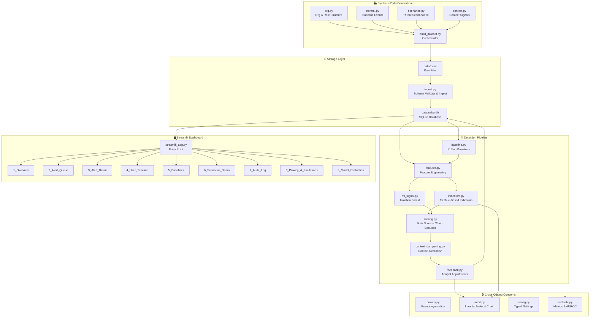
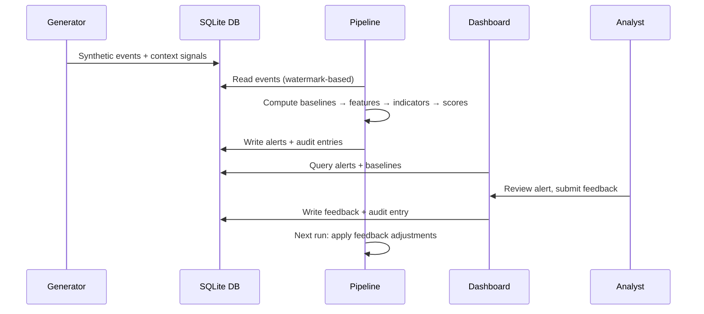
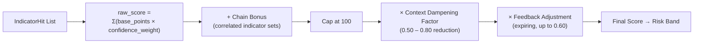

# UEBA Platform — Architecture

## Overview

The UEBA (User and Entity Behaviour Analytics) Platform is a full-stack, locally-deployable insider-threat detection system built in Python.  It combines rule-based behavioural indicators, context-aware dampening, analyst feedback loops, and a supporting ML signal into a transparent, auditable risk-scoring engine.

The platform is intentionally designed to be **explainable first**: every risk score can be traced back to specific events and behavioural baselines.  The ML component (Isolation Forest) adds weight but never overrides the rule-based findings.

---

## High-Level Architecture

---

## Component Descriptions

### Data Generation Layer
| Module | Responsibility |
|--------|---------------|
| `org.py` | Builds the synthetic organisation: 60 employees across 5 departments, 10 contractors, role-to-resource permission maps |
| `normal.py` | Generates 90 days of realistic events (logins, downloads, file access, privilege use) for each user following role-appropriate patterns |
| `scenarios.py` | Injects 8 distinct insider-threat patterns into the event stream after day 75 |
| `context.py` | Generates contextual signals: travel approvals, on-call schedules, project deadlines, role changes |
| `build_dataset.py` | Orchestrates generation and writes outputs to `data/` |

### Storage Layer
- **SQLite** (`data/ueba.db`): Primary store for events, baselines, alerts, feedback, and the audit chain.
- **CSV files** (`data/`): Raw generated data, importable into external tools.

### Detection Pipeline
| Module | Responsibility |
|--------|---------------|
| `ingest.py` | Schema-validates and ingests CSV events; supports incremental watermark-based ingestion |
| `baseline.py` | Computes rolling 60-day per-user behavioural baselines with confidence weighting |
| `features.py` | Engineers temporal, geographic, volumetric, access, and peer-deviation features |
| `indicators.py` | 15 rule-based indicators producing `IndicatorHit` objects with evidence |
| `ml_signal.py` | Trains/scores Isolation Forest; output is ML_ANOMALY_SUPPORT indicator only |
| `scoring.py` | Aggregates hits into 0–100 risk scores, applies chain bonuses |
| `context_dampening.py` | Reduces scores for legitimate contextual explanations |
| `feedback.py` | Applies analyst feedback adjustments with time-limited expiry |
| `pipeline.py` | End-to-end orchestrator |

### Dashboard (Streamlit)
Nine pages covering: system overview, alert triage queue, per-alert deep-dive, user event timeline, baseline inspection, scenario walkthrough, audit log viewer, privacy controls, and evaluation metrics.

### Cross-Cutting Concerns
- **privacy.py**: Pseudonymisation via HMAC-SHA256, IP truncation, role-gated identity resolution
- **audit.py**: SHA-256 chained audit log for tamper detection
- **config.py**: Pydantic settings loaded from YAML + environment variables
- **evaluate.py**: Precision, recall, F1, AUROC against ground-truth scenario labels

---

## Data Flow

---

## Scoring Pipeline Detail

---

## Technology Choices

| Choice | Rationale |
|--------|-----------|
| Python 3.11+ | Wide library ecosystem, type hints, async support |
| SQLite | Zero-setup, file-portable, sufficient for demo scale |
| Streamlit | Rapid data-app development; no frontend build step |
| Plotly | Interactive, embeds cleanly in Streamlit |
| Isolation Forest | Unsupervised, no labels needed, interpretable anomaly scores |
| Pydantic v2 | Typed config validation, fast, composable |
| HMAC-SHA256 | Standard pseudonymisation primitive; reversible only with salt |
| Chained SHA-256 audit | Lightweight tamper detection without a blockchain |
